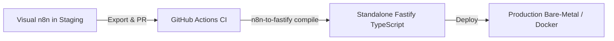

# ⚡ n8n-to-fastify

[](https://github.com/rogeriomaciel/n8n-to-fastify/actions/workflows/ci.yml)
[](https://www.typescriptlang.org/)
[](https://www.fastify.io/)
[](https://bun.sh/)
[](LICENSE)

> **Use n8n as your visual IDE in staging. Compile & deploy pure, bare-metal Fastify microservices to production via CI/CD.**
>
> **[⚡ Try the Live Browser Playground](https://www.rogeriomaciel.com.br/en/n8n-to-fastify/)** *(100% client-side — paste any n8n JSON, zero data leaves your browser)*

**`n8n-to-fastify`** is an Ahead-Of-Time (AOT) compiler that ingests exported n8n workflow JSONs (including nested subworkflows) and transpiles them into standalone, zero-overhead TypeScript/Fastify HTTP services.

---

## 🔥 Why Transpile n8n to Fastify?

Visual workflow engines are incredible for rapid prototyping, debugging, and iterating in staging. However, running an interpreted low-code engine in high-concurrency production introduces severe bottlenecks:

- **Memory Bloat:** Heavy container overhead (> 1.2 GB RAM under burst load).
- **Queue Starvation & DB Locks:** Every execution writes state to `execution_entity` and queues subworkflows.
- **Webhook Latency:** ~180ms–250ms TTFB ACK latency just to wake up the execution engine.

**`n8n-to-fastify` eliminates the runtime interpreter completely.**

| Metric | Traditional n8n Container | Compiled Fastify Microservice | Improvement |
| :--- | :--- | :--- | :--- |
| **Webhook ACK Latency (TTFB)** | ~180ms – 250ms | **< 5 ms** | **~40x faster** |
| **Subworkflow Invocation** | ~300ms – 500ms (DB + IPC) | **< 0.05 ms** (In-memory call) | **~6,000x faster** |
| **RAM Consumption** | > 1.2 GB | **~25 MB** | **~98% RAM reduction** |
| **Circular Dependency Safety** | Runtime crash / infinite loop | **Fail-fast at build-time** | 100% deterministic |

---

## ✨ Key Architectural Features

### 1. In-Memory Subworkflow Transpilation (`Execute Workflow`)
Unlike naive transpilers that only convert single flat workflows, `n8n-to-fastify` parses an entire directory of workflows, registers them into an in-memory `WorkflowRegistry`, and compiles `Execute Workflow` nodes into **direct async TypeScript function calls**. Cross-workflow communication happens in microseconds with zero HTTP hops and zero database locking.

### 2. Strict DAG Topological Sorting & Cycle Detection
Using a Kahn-inspired topological sorter, the compiler validates your visual graph before emitting a single line of code. Circular dependencies fail immediately at CI/CD build-time rather than causing silent infinite loops in production.

### 3. Native Expression Transpiler
n8n expressions like `={{ $json.customer.email }}`, `={{ $('Webhook').item.json.token }}`, and `={{ $env.API_KEY }}` are compiled into safe native JavaScript with deep optional chaining (`?.`).

---

## 🚀 Quick Start

```bash
# 1. Clone the repository
git clone https://github.com/rogeriomaciel/n8n-to-fastify.git
cd n8n-to-fastify

# 2. Install dependencies with Bun
bun install

# 3. Compile the included examples (Main Workflow + Subworkflow)
bun run compile ./examples --out ./compiled-service

# 4. Run the generated Fastify microservice
cd compiled-service
bun install
bun run start
```

Test the compiled endpoint (with subworkflow validation, IF branching, and JSON response):

```bash
# Valid payload -> 200 OK (< 5ms)
curl -X POST http://localhost:3000/webhook/lead-intake \
  -H "Content-Type: application/json" \
  -d '{"name": "Ada Lovelace", "email": "ada@analyticalengine.org"}'

# Invalid email -> 400 Bad Request
curl -X POST http://localhost:3000/webhook/lead-intake \
  -H "Content-Type: application/json" \
  -d '{"name": "Invalid", "email": "not-an-email"}'
```

---

## 🧩 Supported Nodes (v0.1)

| n8n Node | Compiled Native Behavior |
| :--- | :--- |
| **Webhook** | Native Fastify route handler (`GET`, `POST`, `PUT`, `DELETE`, `ALL`) |
| **Respond to Webhook** | `reply.code(status).send(payload)` with JSON/Text support |
| **Code / Function** | Native async JavaScript execution with `$input`, `$json`, and `$('Node')` bindings |
| **Execute Workflow** | Direct in-memory function invocation via `WorkflowRegistry` |
| **IF / Filter** | Deterministic branch tracking (`outputIndex 0` vs `1`) |
| **Switch** | Multi-branch router matching rules + fallback |
| **Set / Edit Fields** | Object mutation with dot-notation & `keepOnlySet` |
| **HTTP Request** | Native `fetch()` with headers, JSON body, and error handling |
| **Aggregate** | In-memory item aggregation |
| **Split Out** | Expands nested arrays into individual `N8nItem[]` items |
| **Merge** | Combines or appends parallel execution branches |
| **PostgreSQL** | Parameterized SQL execution via `DATABASE_URL` |
| **RabbitMQ** | Publish messages to an existing exchange |
| **RabbitMQ Trigger** | Consume a queue and acknowledge delivery after successful execution |
| **OpenAI / Gemini LLM** | Native `fetch()` completion calls via `OPENAI_API_KEY` |
| **Wait** | Non-blocking async `setTimeout` promise |

---

## 🧪 Tests & Reproducible Benchmark

```bash
# Run unit + E2E HTTP integration tests
bun test

# Run 1,000-request TCP loopback benchmark (Main Webhook + Subworkflow + IF + Set)
bun run benchmark
```

Measured output:
- **Compilation Time:** ~2.77 ms
- **Avg Latency:** ~0.53 ms (`p95`: ~0.74 ms)
- **Throughput:** ~1,885 req/s

---

## 🏗️ Visual-to-Bare-Metal CI/CD Pattern



1. **Staging:** Build and iterate visually in n8n.
2. **Pull Request:** Export workflow `.json` files into your repository.
3. **CI/CD:** Run `n8n-to-fastify compile ./workflows --out ./dist`.
4. **Production:** Deploy pure Node.js/Bun containers with zero n8n runtime overhead.

---

## Strict compatibility checks

```bash
bun run compile ./workflows --strict --out ./compiled-service
```

In strict mode, the CLI reports known unsupported features by workflow and
node and stops before writing output. Checks include unsupported nodes,
non-main connections, disabled nodes, unsupported error handling, selected
HTTP Request and Edit Fields options, and Combine mode with more than two
inputs. In strict mode, put only workflow exports in the input directory.
Invalid JSON and JSON files without a workflow stop compilation.

Passing these checks means none of the known issues were detected. To verify
behavior, compare the generated service against representative n8n runs.

---

## RabbitMQ publisher

The compiler supports the RabbitMQ **Send Message** operation in **Exchange**
mode with default options, using node versions 1 and 1.1 from n8n 1.123.5.
Declare and bind the exchange before starting the service. Set
`RABBITMQ_URL` to the broker's AMQP or AMQPS connection URL at runtime.
The generated manifest includes `amqplib` when a workflow uses this node.

The publisher evaluates the exchange and routing key using the first input
item and publishes one message per item. It waits for broker confirmation.
The output preserves the n8n `{ success }` shape, where the boolean reflects
whether the client's write buffer can accept more messages.

## RabbitMQ trigger

The compiler supports RabbitMQ Trigger v1 from n8n 1.123.5 with
`executionFinishesSuccessfully`. Set the same `RABBITMQ_URL` as for publishing.
The generated service checks the queue, optionally declares it with
`assertQueue`, and binds it to existing exchanges. Set `parallelMessages`
to limit unacknowledged deliveries. Disabled triggers do not start consumers.

Each delivery starts the selected trigger branch with one item containing
the message fields, properties and text body, or a parsed JSON body when
`jsonParseBody` is enabled. The consumer acknowledges after success and
requeues on failure. On shutdown it cancels the consumer, waits for in-flight
executions, and closes its connection.

---

## 👤 Author & Enterprise Migration Consulting

Built by **[Rogério Maciel](https://rogeriomaciel.com.br/en/)** — Software Architect (20+ years in production systems, Ex-Head at Neoway, Ex-CTO).

Need help migrating high-volume n8n infrastructure (50+ workflows, custom database connectors, Prometheus telemetry, Kubernetes CI/CD) to bare-metal Fastify? Reach out via [GitHub](https://github.com/rogeriomaciel) or [rogeriomaciel.com.br](https://rogeriomaciel.com.br/en/).

---

## 📄 License

MIT © [Rogério Maciel](LICENSE)
